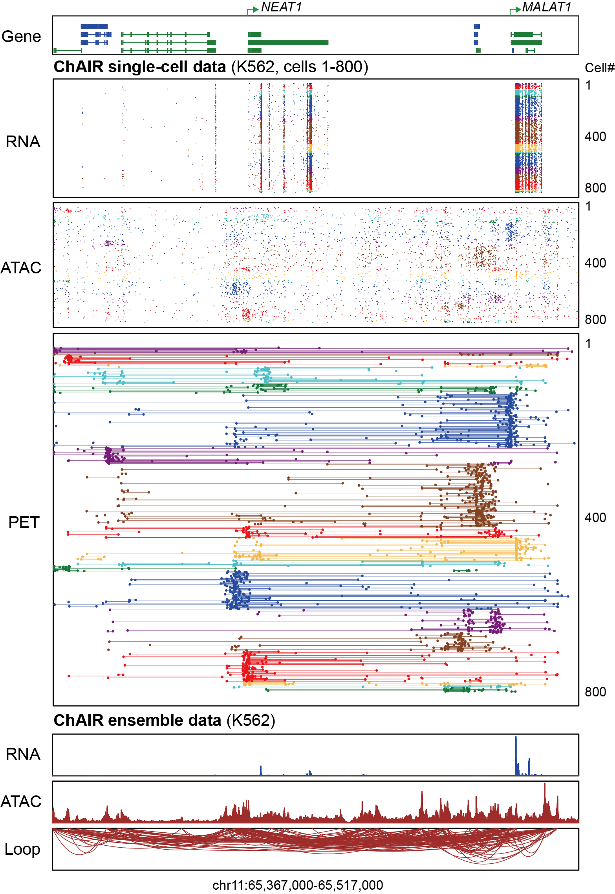

# ChAIR-Viewer

ChAIR-Viewer displays aligned single-cell RNA, ATAC and PET tracks, gene annotations and ensemble RNA/ATAC coverage and chromatin loops. Cells can be ordered by PET contact profiles, RNA/ATAC signal or contact counts.

## Setup

```bash
git clone -b protocol-revision-20261105 https://github.com/Chang-An2002/ChAIR-Viewer.git
cd ChAIR-Viewer
```

Use the `chair-r` R environment prepared in the [ChAIR-PIPE installation instructions](https://github.com/Chang-An2002/ChAIR-PIPE/tree/protocol-revision-20261105#installation). The Viewer uses RColorBrewer, pheatmap, plotrix, dplyr and GenomicRanges.

## Prepare inputs

For a completed ChAIR-PIPE analysis, run its `codes/prepare_viewer_inputs.sh` script. It creates a directory containing the following files and an `inputs.tsv` manifest:

| Track key | File/format |
| --- | --- |
| `genes` | Eight columns: chrom, start, end, transcript, gene, score, strand, feature type |
| `rna`, `atac` | Five columns: chrom, start, end, barcode, count |
| `pet` | Eleven columns: chrom1, start1, end1, chrom2, start2, end2, barcode, readID, score, strand1, strand2 |
| `peaks` | Three columns: chrom, start, end |
| `rna_rpkm`, `atac_rpkm` | Four-column RPKM bedGraph: chrom, start, end, value |
| `loops` | Ten columns: chrom1, start1, end1, chrom2, start2, end2, count, anchor1 coverage, anchor2 coverage, VC_sqrt score |
| `chromstat` (optional) | Nine-column chromatin-state BED including itemRgb |

`inputs.example.tsv` shows the manifest structure. The first line is `track<TAB>path`; relative paths are resolved from the manifest directory. Plain and gzip-compressed tables are supported. RNA, ATAC and PET use matching cell barcodes and the same genome assembly. Ensemble tracks describe the sample-level aggregate signal.

## Load the manifest

```bash
conda run --no-capture-output -n chair-r Rscript readInfo.R \
  --manifest /data/viewer/K562/inputs.tsv /data/viewer/K562/K562.all.data.RData
```

The command saves the objects used by `loadData()` and `run()` in one RData file. The manifest supplies the sample file paths directly.

## Plot the K562 example region

```bash
conda run --no-capture-output -n chair-r Rscript plotData.R \
  /data/viewer/K562/K562.all.data.RData \
  chr11:65367000-65517000 \
  /data/viewer/K562/K562.NEAT1_MALAT1.pdf \
  800 3 0.001
```

The last three arguments are the displayed cell count, minimum ensemble-loop contact count and minimum VC_sqrt score. Their defaults are 800, 3 and 0.001. The plotting entry uses PET-profile hierarchical clustering and selects cells with RNA, ATAC and PET signals in the requested region. PDF output includes a CSV of the displayed cell order beside the figure. A `.png` output extension selects PNG format.

Advanced plotting options are available through `loadData()` and `run()` in `source.r`.

## K562 example



A browser-based visualization of K562 ChAIR single-cell tracks and ensemble ChAIR data.
The genes in green are oriented in the 5′-3′ direction, while the genes in blue are in the 3′-5′ direction. The top 800 cells of single-cell data with the most chromatin contacts and also with all three modalities available within the displayed region are visualized. The cells were sorted in order based on the hierarchical clustering of the ChAIR-PET data. The color assigned to each cluster is for distinguishing nearby clusters.

<details>
<summary>Legacy filename-based input preparation</summary>

The three-argument reader remains available for existing datasets:

```bash
Rscript readInfo.R genes.bed SAMPLE chromatin_states.bed
```

Filename-based reader conventions and annotation commands:

#### 1. Only the two longest and two exon most transcripts are retained (Convenient output of gene annotation track) (Optional)
```
python getMaxlengthRNA.py ~/cellranger-7.1.0/genome/refdata-gex-mm10-2020-A/genes/genes.gtf | grep -v "^#" | awk '$3=="exon" || $3=="UTR"'|perl -lane '$id="#";$id=$1 if(/transcript_id "(.+?)"/);$name="#"; $name=$1 if(/gene_name "(.+?)"/); print "$F[0]\t".($F[3]-1)."\t$F[4]\t$id\t$name\t0\t$F[6]\t$F[2]"' > mm10.genome.max.bed
```
else
```
cat ~/cellranger-7.1.0/genome/refdata-gex-mm10-2020-A/genes/genes.gtf | grep -v "^#" | awk '$3=="exon" || $3=="UTR"'|perl -lane '$id="#";$id=$1 if(/transcript_id "(.+?)"/);$name="#"; $name=$1 if(/gene_name "(.+?)"/); print "$F[0]\t".($F[3]-1)."\t$F[4]\t$id\t$name\t0\t$F[6]\t$F[2]"' > mm10.genome.max.bed
```

#### 2. Prepare all data (Convenient for multiple calls)
The readInfo.R script is used to organize the input files, and needs to be modified by the user according to your actual situation.
```
mkdir alldata
Rscript readInfo.R mm10.genome.max.bed mouseBrain mouseBrain.chromstat.hmm.bed
```
The program searches the current directory for the following files and stores all results as an RData object.

file|description
:---:|:---:
mouseBrain.clean.ATAC.mouseBrain.fragments.unsorted.tsv|scATAC fragment file
mouseBrain.clean.ATAC.mouseBrain.q001_peaks.final.bed|peak file (3 columns)
mouseBrain.clean.ATAC.mouseBrain.bedgraph|scATAC coverage signal
mouseBrain.clean.ATAC.mouseBrain.RPKM.bedgraph|scATAC coverage signal by using RPKM normalization
mouseBrain.clean.PET.bedpe.mouseBrain.bedpe|scPET file (11 columns: chrom1, start1, end1, chrom2, start2, end2, barcode, readID, score, strand1, strand2)
mouseBrain.clean.PET.bedpe.mouseBrain.clusters.bedpe|loop file (no given anchor model) (7 columns: chrom1, start1, end1, chrom2, start2, end2, contact count)
mouseBrain.clean.PET.bedpe.mouseBrain.clusters.twopeaks.bedpe|loop file (no given anchor model) (overlap with peak) (7 columns: chrom1, start1, end1, chrom2, start2, end2, contact count)
mouseBrain.clean.PET.bedpe.mouseBrain.bedpe.ipet.loops|loop file ( given anchor model) (10 columns: chrom1, start1, end1, chrom2, start2, end2, contact count, anchor1 coverage, anchor2 coverage, VC_sqrt score)
mouseBrain.clean.GEX.mouseBrain.bedgraph|scRNA coverage signal
mouseBrain.clean.GEX.mouseBrain.RPKM.bedgraph|scRNA coverage signal by using RPKM normalization
mouseBrain.clean.dup.GEX.mouseBrain.bedgraph|scRNA (contain mapped reads from intergenic) coverage signal. (If there is no mouseBrain.clean.dup.GEX.mouseBrain.bedgraph file, you can copy the mouseBrain.clean.GEX.mouseBrain.bedgraph file)
mouseBrain.clean.dup.GEX.mouseBrain.RPKM.bedgraph|scRNA (contain mapped reads from intergenic) coverage signal by using RPKM normalization. (If there is no mouseBrain.clean.dup.GEX.mouseBrain.RPKM.bedgraph file, you can copy the mouseBrain.clean.GEX.mouseBrain.RPKM.bedgraph file)
mouseBrain.clean.GEX.mouseBrain.fragments.unsorted.tsv|scRNA fragment file
mouseBrain.clean.dup.GEX.mouseBrain.fragments.unsorted.tsv|scRNA (contain mapped reads from intergenic) fragment file. (If there is no mouseBrain.clean.dup.GEX.mouseBrain.fragments.unsorted.tsv file, you can copy the mouseBrain.clean.GEX.mouseBrain.fragments.unsorted.tsv file)

#### 3. plot
```
Rscript plotData.R alldata/mouseBrain.mouseBrain.chr19.data.RData chr19:5500000-6500000 mouseBrain.Viewer.pdf
```

</details>

## Contact

黄加祥 (Jiaxiang Huang, 12207142@zju.edu.cn)  
黄星宇 (Xingyu Huang, xingyu.huang@zju.edu.cn/huang182@live.cn)
